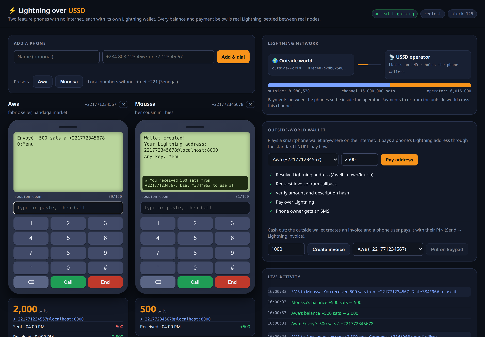
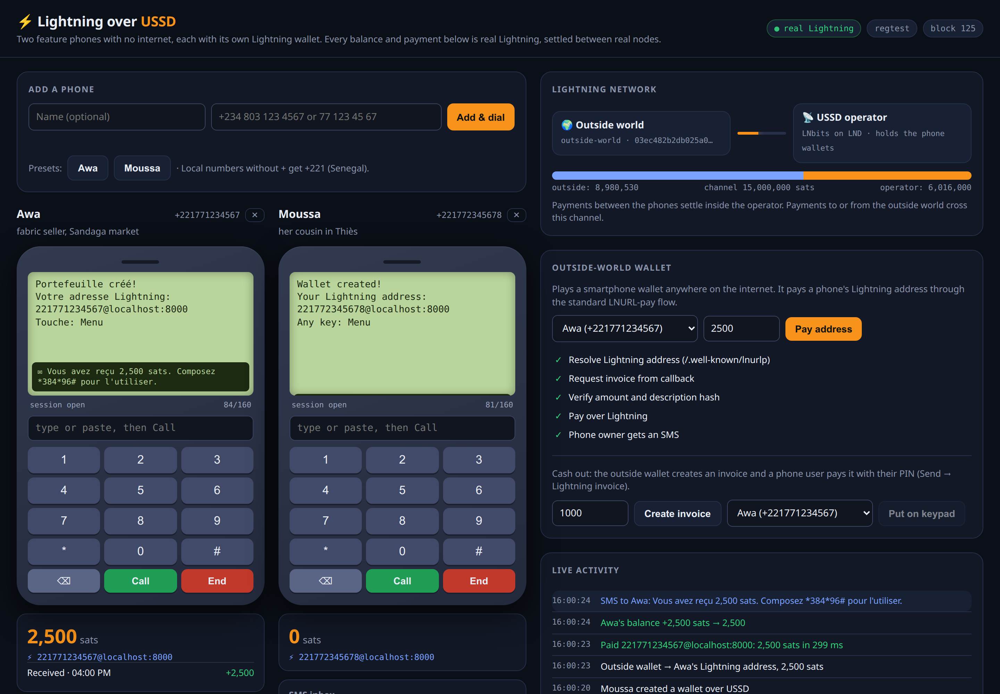

# USSD-LNbits Gateway

**A Bitcoin Lightning wallet for any phone. No smartphone, no internet, no app.**

Dial a shortcode such as `*384*96#`, pick English or French, set a PIN, and you have your own Lightning wallet. Send sats to another phone number, receive at a Lightning address that anyone in the world can pay, and get an SMS when money arrives.

Built for the [Dakar Bitcoin Hack 2026](https://dakar-bitcoin-hack-2026.devpost.com/) (BTrust).



## The problem

Every Lightning wallet assumes a smartphone and a data plan. Many of the people who would gain most from cheap, borderless payments don't have one:

- **About 4 in 10 people in Senegal don't use the internet**: 60.6 % penetration at the start of 2025, roughly 7 million people offline ([DataReportal, Digital 2025: Senegal](https://datareportal.com/reports/digital-2025-senegal)).
- **Across Sub-Saharan Africa, 65 % of people live within mobile-internet coverage but don't use it** (2024, GSMA via [TechAfrica News](https://techafricanews.com/2025/09/18/65-of-sub-saharan-africa-are-still-offline-despite-coverage-a-look-at-the-connectivity-paradox/)). Cost of a smartphone and data is a main reason ([GSMA, State of Mobile Internet Connectivity 2025](https://www.gsma.com/somic/wp-content/uploads/2025/11/The-State-of-Mobile-Internet-Connectivity-2025-Affordability-of-Internet-Enabled-Handsets-and-Data.pdf)).
- **Sending $200 to Sub-Saharan Africa costs 8.46 % on average**, the most expensive region in the world (World Bank Remittance Prices Worldwide, Q3 2025, via [African Exponent](https://www.africanexponent.com/chart-of-the-day-sending-200-home-to-sub-saharan-africa-costs-8-46-percent/)).

Those people already use USSD every day for mobile money. This puts Lightning on the same `*code#` menus: market vendors, and families receiving money from relatives abroad, can be paid from any Lightning wallet in the world.

## What it does

| | |
|---|---|
| **Own wallet per phone** | First dial creates a separate LNbits account for that number. No shared wallet. |
| **Send to a phone number** | `3 → 1 → 772345678 → 500 → PIN`. Settles instantly inside LNbits, no fee. The recipient gets an SMS. |
| **Receive from anyone** | Every user has a Lightning address, `221771234567@your-domain`, payable from any Lightning wallet (LNURL-pay). |
| **Invoices by SMS** | A Lightning invoice is 250+ characters and a USSD screen holds 160, so "Request an amount" texts you the full invoice to forward. |
| **Payment alerts** | SMS when an invoice or Lightning address payment arrives (LNbits webhook). |
| **PIN on every payment** | PBKDF2-hashed 4-digit PIN; three wrong tries lock sending for 30 minutes. |
| **English and French** | Bilingual first screen; switch any time in Settings. |
| **Balance and history** | Last 5 transactions, paginated to fit the screen. |

```
Lightning Wallet          Envoyer à:                 Envoyer 500 sats à
1. Check Balance          1. Numéro de téléphone     +221772345678?
2. Receive Payment        2. Facture Lightning       Entrez le PIN pour
3. Send Payment           0:Menu                     confirmer:
4. History                                           0:Menu
5. Settings
6. Exit
```

## Architecture

```
Feature phone ──USSD──▶ Africa's Talking ──HTTPS POST /ussd?key=…──▶ Gateway (FastAPI) ──REST──▶ LNbits ──▶ Lightning
      ▲                        │                                       │      │                    │
      └──────── SMS ───────────┘◀──────────── SMS API ─────────────────┘   Redis ◀── paid webhook ─┘
                                                                     (sessions, phone wallets)
Any Lightning wallet ──pays 221771234567@domain (LNURL-pay)──▶ Gateway
```

Each keypress is one HTTP request. The gateway is stateless; sessions and phone wallets live in Redis.

**Stack:** Python 3.12, FastAPI, Redis, LNbits 1.6 on LND 0.18, Bitcoin Core 27 (regtest), Africa's Talking (USSD + SMS), Docker Compose.

## Run it locally (real Lightning, no real money)

Requirements: Docker with Compose, `jq`, `openssl`.

```bash
git clone https://github.com/Manuelshub/USSD-LNbits-gateway.git
cd USSD-LNbits-gateway
scripts/regtest_bootstrap.sh
```

That one command (about 40 seconds on a fresh clone) starts a private **regtest** Lightning network and everything on top of it:

- `bitcoind` (regtest) and two LND nodes: **ussd-operator**, the operator's node that LNbits runs on, and **outside-world**, standing in for every other Lightning wallet on the internet
- a 15,000,000 sat channel between them, with balance on both sides
- LNbits on the operator's LND (not FakeWallet), the gateway, Redis
- `.env` with an operator wallet and demo settings, then a real Lightning payment into it as a smoke test

Open **http://localhost:8000/demo**: feature phones side by side, the Lightning channel with its live balances, an outside-world wallet that pays Lightning addresses, and a feed of everything that happens.



Demo script:
1. **Add a phone** with your own number (any country; local Senegalese numbers need no +221), then a second one. Each phone dials as soon as it is added, and a new number creates its own wallet: language, PIN, PIN again. Awa and Moussa are one-click presets.
2. Outside-world wallet: **pay your phone 2,500 sats**. It resolves the Lightning address, fetches an invoice, checks the description hash and pays over the channel. The balance updates and an SMS pops up on the phone's screen.
3. On that phone: `3` Send → `1` Phone number → the other number → `500` → PIN. The other phone gets the sats and an SMS.
4. Cash out: create an invoice in the outside-world wallet, **Put on keypad** for a phone, then on it `3` → `2` → Call → PIN. The sats leave the operator over Lightning.

The phone list is kept in your browser; removing a phone does not delete its wallet.

After restarting Docker, run `scripts/regtest_bootstrap.sh` again (a few seconds; it reconnects the nodes). `scripts/reset_demo.sh` forgets all demo phones for a clean recording.

From a terminal instead of the browser: `python scripts/ussd_sim.py --phone +221771234567`.

**Lighter mode:** `docker compose up -d` alone runs LNbits on FakeWallet (no Lightning nodes). Balances are then ledger entries; `scripts/setup_demo.sh` credits the operator wallet for the demo faucet.

## Going live with Africa's Talking

1. Deploy behind HTTPS and set `PUBLIC_URL=https://your-domain`.
2. Set `USSD_CALLBACK_SECRET` and register `https://your-domain/ussd?key=<secret>` as the USSD callback (POST).
3. Set `AT_USERNAME` and `AT_API_KEY` for SMS, `USSD_CODE` to your shortcode.
4. Allow your gateway's URL in LNbits' callback URL rules (Admin UI → Server) so paid alerts work.
5. Keep `DEMO_MODE=false`, and run LNbits on a mainnet funding source (your own LND or CLN, Phoenixd, Blink...) instead of the regtest nodes.

All settings are listed in [.env.example](.env.example).

## Security

### Threats and mitigations

| Threat | Mitigation |
|---|---|
| Someone else picks up the phone and sends money | 4-digit PIN on every payment, PBKDF2-SHA256 with a per-user salt, constant-time check. Weak PINs (1111, 1234...) refused. 3 wrong PINs lock sending for 30 minutes. |
| A forged USSD request claims a victim's number | Africa's Talking doesn't sign callbacks, so `/ussd` requires a shared secret (`/ussd?key=...`, constant-time check). The gateway refuses to start without it unless `DEMO_MODE=true`. The PIN is still needed to move funds. |
| One user reaches another's wallet | One LNbits **account** per phone, not just a wallet. No shared fallback wallet. |
| USSD users spend the operator's funds | The operator wallet is never bound to a phone. |
| Fake "you received" SMS through the webhook | Secret webhook path, and the payment is re-checked with LNbits before any SMS goes out. |
| Phone numbers or PINs leak through logs | Numbers masked (`+221*******67`) in app, audit and HTTP access logs. Raw USSD input is never logged, because it contains PINs. API keys masked. |
| A leaked key does too much | Balance, invoices and history use the read-only invoice key. Only paying uses the admin key. |

### Known gaps

- **Redis holds each phone's LNbits admin key and PIN hash.** A 4-digit PIN hash can be brute-forced offline, so Redis must stay private (it isn't published by the compose file). Next: Redis AUTH/TLS and encrypted records.
- **SIM swap** gives an attacker the phone number, though they still need the PIN. Next: daily send limits and a recovery flow.
- **A Lightning address reveals the phone number.** Next: optional aliases.
- **Custodial by design:** the operator's LNbits holds users' funds, as with any USSD wallet. Run it as a community or cooperative you trust.
- `DEMO_MODE=true` opens the `/demo` pages and faucet. Demo only.

## Tests

```bash
python -m venv .venv && .venv/bin/pip install -r requirements.txt
.venv/bin/pytest
```

With the regtest stack running, one script checks every component together (Lightning nodes and channel, LNbits, Redis, every menu, Lightning addresses, invoices by SMS, the paid webhook, PINs and lockout, cash out, the callback secret, log masking, 160-character screens, concurrent sessions and a gateway restart):

```bash
.venv/bin/python scripts/system_test.py     # 60 checks, about 20 s
```

Unit, integration and property-based (Hypothesis) tests cover registration, PIN lockout, phone-to-phone sends, invoices by SMS, Lightning addresses, the webhook, the callback secret, log masking, and that every screen in both languages fits in 160 characters.

## Constraints

- A USSD screen holds 160 characters; invoices are delivered by SMS and receiving uses Lightning addresses.
- Paying an arbitrary merchant invoice from USSD still means typing it; phone-to-phone covers the everyday case.
- The demo network is regtest: real Lightning nodes, channels and payments, but a private chain, so nobody outside can pay with their own phone wallet. Pointing LNbits at a mainnet backend (Blink, Phoenixd, LND...) is a configuration change.
- USSD sessions time out after about 90 seconds (operator dependent).

## Metrics we will track

Registrations per day and 7-day activation; transfers per week and median amount; Lightning address payments received; session drop-off per menu step; wrong-PIN and lockout rate.

## Next steps

1. Pay a Lightning address or short merchant code from USSD.
2. Wolof menus, with a native speaker.
3. Daily send limits and PIN recovery.
4. Operator admin screen: unlock PINs, disable phones, see activity.
5. Signet pilot with Africa's Talking in Senegal.

## License

MIT, see [LICENSE](LICENSE).

## Acknowledgments

BTrust and Dakar Bitcoin Days; LNbits; Africa's Talking; Machankura, who showed Bitcoin over USSD works in Africa.
